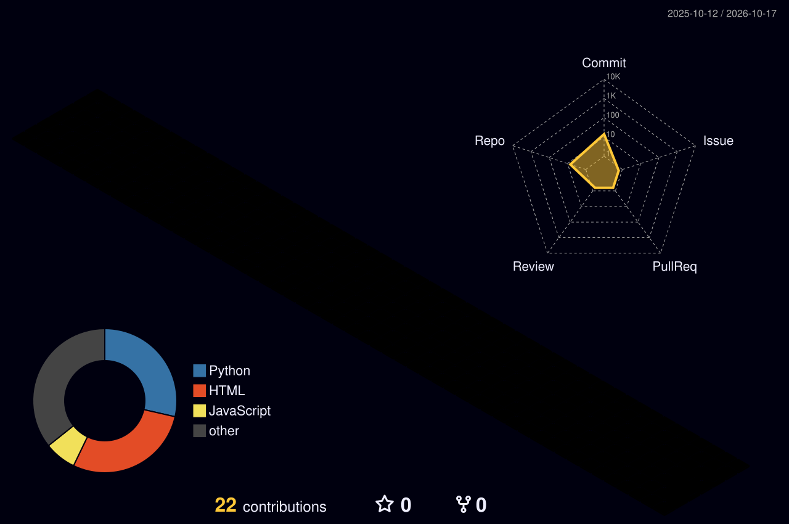

# 안녕하세요, 서민형입니다 👋

### 🧪 재료공학 × 🤖 AI — 소재의 미래를 데이터로 설계하고 싶은 AI 교육생

---

## 🙋 About Me

- 🎓 **AI 교육 과정**에서 Python, 컴퓨터 비전, LLM 활용 웹 서비스를 배우고 있는 교육생입니다.
- 📂 배운 내용은 매일 직접 만들어 보고 **GitHub에 기록**하며 성장 과정을 남기고 있습니다.
- 🔬 **재료공학** 전공 지식을 바탕으로, AI를 소재 연구에 접목하는 것이 목표입니다.
- 💡 "배운 것은 바로 만들어 본다" — 작은 게임부터 실습 강의 자료까지 손으로 익히는 걸 좋아합니다.

## 🧪 Materials Engineering × AI

재료공학과 AI가 만나는 지점에서 이런 일을 해보고 싶습니다.

| 분야 | 하고 싶은 일 |
|:---:|:---|
| 🔍 **미세조직 분석** | SEM·광학현미경 이미지를 YOLO 등 컴퓨터 비전으로 분석해 결정립·결함·상(phase)을 자동 검출 |
| 📈 **물성 예측** | 조성·공정 조건 데이터로 강도·경도·전도도 등 물성을 머신러닝으로 예측 |
| ⚗️ **신소재 탐색** | 머티리얼즈 인포매틱스(Materials Informatics)로 실험 횟수를 줄이고 후보 소재를 빠르게 선별 |
| 📚 **연구 보조 LLM** | 논문·실험 노트를 요약·검색하는 LLM 기반 연구 어시스턴트 |

> 지금 배우는 **객체 탐지(YOLO)**, **랜드마크 추출(MediaPipe)**, **LLM API 활용**이 모두 위 목표로 이어지는 디딤돌입니다.

## 🛠 Tech Stack

**Languages** 

**AI / Computer Vision** 

**Web / Tools** 

## 📅 Learning Log

> 교육 과정에서 만든 결과물을 날짜순으로 정리했습니다. 🔒 표시는 비공개 저장소입니다.

### 2026.10.07 — 컴퓨터 비전 첫걸음 👀
| 프로젝트 | 내용 | 기술 |
|:---|:---|:---|
| [brick-breaker](https://github.com/ranma0831-lang/brick-breaker) | 브라우저에서 즐기는 벽돌깨기 게임 |  |
| 🔒 pose-snake-game | 몸 동작(포즈 인식)으로 조작하는 스네이크 게임 |  |
| 🔒 yolo26-webcam | YOLO26으로 웹캠 실시간 객체 탐지 |  |
| 🔒 mediapipe-hand-landmarker-lecture3 | 강의 3: MediaPipe Hand Landmarker 웹캠 실습 |  |

### 2026.10.12 — LLM 서비스 & 강의 자료 제작 ✨
| 프로젝트 | 내용 | 기술 |
|:---|:---|:---|
| 🔒 mbti-fortune | 별나 — 별자리 × MBTI 주간 운세 웹 서비스 |   |
| 🔒 electronics-basics-lecture | 비전공자용 전자전기 기초 특강 PPT (python-pptx + manim) |  |

### 2026.10.13 — 로컬 LLM을 위한 하드웨어 🖥️
| 프로젝트 | 내용 | 기술 |
|:---|:---|:---|
| [llm-pc-builder](https://github.com/ranma0831-lang/llm-pc-builder) | 예산 슬라이더로 로컬 LLM용 PC 조합을 계산하는 견적 사이트 |  |

### 2026.10.15 — 웹 미니 게임 🎮
| 프로젝트 | 내용 | 기술 |
|:---|:---|:---|
| [boss-errand-jump](https://github.com/ranma0831-lang/boss-errand-jump) | 신입 김사원이 부장님 심부름으로 편의점까지 점프하는 미니 게임 |  |

### 2026.10.16 — Python & Git 기초 다지기 🌱
| 프로젝트 | 내용 | 기술 |
|:---|:---|:---|
| [python-lecture](https://github.com/ranma0831-lang/python-lecture) | Python 강의 실습 정리 |  |
| [gitexcercise](https://github.com/ranma0831-lang/gitexcercise) | Git 사용법 연습 샘플 |  |
| [ranma0831-lang](https://github.com/ranma0831-lang/ranma0831-lang) | 지금 보고 계신 GitHub 프로필 포트폴리오 |  |

## 🌱 3D Contributions

## 🎯 Goals

- [x] Git / GitHub로 학습 기록 시작하기
- [x] 컴퓨터 비전(YOLO, MediaPipe) 웹캠 실습
- [x] LLM API를 활용한 웹 서비스 만들기
- [ ] 재료 미세조직 이미지 데이터셋으로 객체 탐지 모델 학습해 보기
- [ ] 소재 물성 데이터로 머신러닝 예측 모델 만들기
- [ ] 재료공학 × AI 융합 프로젝트 완성하기

---

**"재료를 아는 AI 엔지니어"를 향해 매일 한 칸씩 잔디를 심고 있습니다 🌿**

